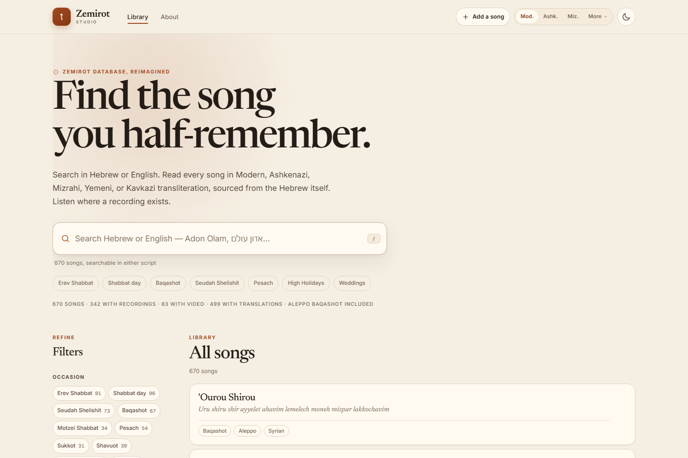
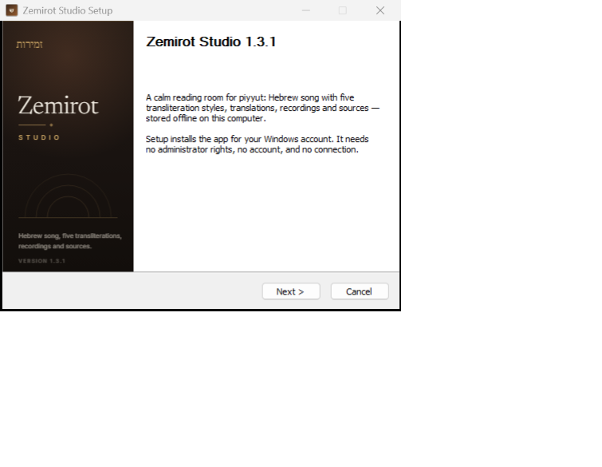

# Zemirot Studio

A calm, fast reading room for the [Zemirot Database](https://www.zemirotdatabase.org/) — 670 zemirot with bilingual search, five pronunciation-aware transliterations, filters, recordings, and an optional local writing assistant. It runs as a static web app and as a Windows desktop app that can also pull songs added to the archive after this release.



Zemirot Studio is an independent interface, not affiliated with the archive. Song texts, translations, and recordings belong to their contributors; see [Data and copyright](#data-and-copyright).

## What's inside

- **670 songs bundled** — 603 from the Zemirot Database plus 67 Syrian (Aleppo) Baqashot. Adding your own songs is a button, not a fork.
- **Search across both scripts** — English titles, Hebrew titles, first lyric lines, and transliterations. Hebrew matching ignores niqqud and final-letter forms; Latin matching folds diacritics, so `ḥayyim`, `chayim`, and `Hayyim` all meet.
- **Five transliteration systems** — Modern, Ashkenazi, Mizrahi, Yemeni, and Kavkazi, generated from the Hebrew text itself rather than copied from the source site. Switch at any time; song pages can show all five in columns beside the Hebrew.
- **Filters** — occasion, tradition, nusach, language, and whether a recording or translation exists.
- **Recordings and video** — streamed from the source site; nothing is downloaded or re-hosted.
- **Desktop extras** — check the archive for new songs on demand or at launch, and draft a translation or context note with [Ollama](https://ollama.com) on your own machine.
- **No accounts, no analytics, no project server.** Search and transliteration are local code; your preferences and added songs stay in local storage on your computer.

## Requirements

- **Node.js 22.12 or newer** (Electron 44 requires it; Vite 6 and Vitest 3 are happy on 18, 20, or 22). Tested with Node 22.23 on Windows 11.
- npm 10+ (ships with Node 22).
- A desktop session for the Electron app; the browser edition needs only the dev server.
- Optional: [Ollama](https://ollama.com/download) if you want local AI drafts.
- Optional: a Word Baqashot songbook (`.docx`) if you intend to regenerate the Aleppo collection — it is not in this repository.

The app itself is fully offline once installed. Only the archive update check, recording playback, and the Google Fonts used by the interface reach the network.

## Quick start (browser edition)

```sh
git clone ssh://git@codeberg.org/Archaejon/Zemirot.git
cd Zemirot
npm ci
npm run dev
```

Vite prints the address, normally <http://127.0.0.1:5183/>; the port is set in `vite.config.ts` and `strictPort` is off, so trust the printed URL if 5183 is taken. Open it and the library loads from `public/data/`.

The browser edition has no archive update check and no writing assistant: both need the Electron main process. Reading, search, transliteration, filters, compare view, and your own songs all work.

## Run the desktop app

```sh
npm run desktop
```

That runs the full build (`tsc --noEmit`, `vite build`, and the bundled updater) and then starts Electron. To relaunch without rebuilding, after a successful build:

```sh
npx electron .
```

The main process serves the built `dist/` folder over loopback HTTP instead of loading it with `file://`, so absolute asset paths, JSON fetches, and the hash router behave exactly as in a browser. It prefers port **47823**; set `ZS_PORT` to change it, and note that a different port is effectively a different site for `localStorage`, so your own songs and preferences would not appear. If the port is busy the app falls back to a temporary port, which is why the log says so.

Closing the window quits the process on Windows and Linux (macOS keeps the app running, as usual), and the loopback server stops with it.

## Build a Windows installer

```sh
npm run package:win
```

electron-builder produces `release/Zemirot-Studio-Setup-<version>.exe`: an NSIS wizard with a branded welcome page, an install-location step, and a finish page that can open the app. It installs for the current Windows account — no administrator prompt — with start-menu and desktop shortcuts, and uninstalling leaves your own songs and settings alone.



The installer artwork in `build/installerSidebar.bmp`, `build/uninstallerSidebar.bmp`, and `build/installerHeader.bmp` is rendered from `scripts/installer-art/` by `npm run art:installer`; `npm run package:win` runs that first, so the bitmaps always match the app's typography.

The build is not code-signed yet, so Windows shows "Windows protected your PC" on first run. `npm run check:signature` reports the Authenticode state of every file in `release/`, and [docs/signing-windows.md](docs/signing-windows.md) explains the certificate options and how to enable signing once one exists.

To hand the file to someone over loopback without uploading it anywhere:

```sh
npm run download-page
```

That serves a small page with the installer's size and SHA-256 on `127.0.0.1:4599` (`PORT` overrides). Packaging is configured for Windows x64 only; there is no macOS or Linux target in `package.json`.

## Checks

```sh
npm run typecheck   # tsc --noEmit
npm test            # vitest run — 69 tests in 7 files, no network
npm run build       # typecheck, production bundle, updater bundle
```

Tests cover transliteration, search matching, compare rows, the custom-song edition, archive update helpers, pronunciation data, and the assistant's error handling. They run in a Node environment (`vite.config.ts`), so no browser or Electron is needed.

## Project layout

```
src/
  components/     library, song page, compare view, writing assistant, dialogs
  lib/            search, transliteration, pronunciation, edition, updates, types
  styles.css      the whole interface, light and dark
desktop/
  main.cjs        Electron window, loopback static server, update check, IPC
  preload.cjs     the narrow window.zemirot bridge (updates + assistant only)
  assist.cjs      prompts, JSON validation, draft records, concurrency
  ollama.cjs      the only Ollama HTTP client
  update-library.cjs  generated by `npm run build:update`; do not edit
scripts/
  scrape.ts       build public/data from the source site (cached, polite)
  parse-song.ts   the HTML parser shared by the scraper and the updater
  vocalize.ts     pointing and pronunciation helpers used at build time
  import-baqashot.ts  import a Baqashot .docx into the bundled collection
  check-updates.ts    maintainer view of archive songs missing from the snapshot
  build-update-bundle.mjs  esbuild bundle of the updater for the packaged app
  serve-download.mjs  loopback download page for the installer
public/data/      the bundled snapshot: index, per-song records, Baqashot, data notice
LICENSE           MIT for the code; the song data is excluded
docs/             the local-AI guide and screenshots
download/         the template for the download page
build/            icons for the installer
```

## Data and copyright

The app reads a bundled snapshot generated on 19 October 2026:

- `public/data/library.json` — the compact index used for search and browsing.
- `public/data/songs/<id>.json` — one full record per archive song.
- `public/data/baqashot/` — the Aleppo collection, same shape.
- `public/data/meta.json` — counts and provenance.

To rebuild the archive snapshot from the source site:

```sh
npm run scrape              # crawl, reusing .cache/ when present
npm run scrape -- --refresh # ignore the cache and re-fetch everything
npm run scrape:cache        # parse the cache only, no network
npm run scrape -- --limit=25  # sample a few pages while iterating
```

The crawler identifies itself with a project user agent and pauses between requests. Raw HTML is cached under `.cache/html/`, which is git-ignored. Re-run the build afterwards so the app picks the new data up.

Other data commands:

```sh
npm run check:updates                          # list archive songs missing from the snapshot
npm run import:baqashot -- "Baqashot V2.docx"  # rebuild the Baqashot collection (--dry to preview)
```

**Copyright.** Song texts, translations, notes, audio, and video come from zemirotdatabase.org and remain with their contributors and performers. They may be public domain, used with permission, or licensed; check the [source copyright policy](https://www.zemirotdatabase.org/copyright.php) before redistributing the data in `public/data/`. The Baqashot texts come from a printed songbook and carry the same caveat. This repository grants no rights to that material.

## Desktop architecture

```
React renderer (dist/, served from 127.0.0.1)
  └─ preload bridge (window.zemirot)
       └─ Electron main process
            ├─ static server over dist/, with an overlay of fetched songs
            ├─ update check  → zemirotdatabase.org, politely
            └─ writing assistant → Ollama or an OpenAI-compatible endpoint
```

Archive updates are fetched into the app's user-data folder, and the server prefers those files over the bundled snapshot, so the shipped app can stay a fixed snapshot while the collection grows. Fetched records live under `archive-updates/`, drafts under `assist/`, the assistant settings in `assist-settings.json`, and the update preferences in `settings.json` — all inside `app.getPath("userData")`, which on Windows is `%APPDATA%\zemirot-studio`.

The renderer never touches the filesystem, Node APIs, or a model endpoint directly; the preload script exposes only the update and assistant calls.

## Optional local AI

Off by default, local by default, and entirely optional: with no provider configured the app behaves exactly as before. Setup, settings, privacy notes, and the browser-edition rationale are in [docs/local-ai.md](docs/local-ai.md). The short version:

```sh
ollama pull gemma3:4b
```

Then in the desktop app open **About → Writing assistant**, choose **Local · Ollama**, and press **Check connection**. The app never starts Ollama, polls it, or downloads a model, and it sends no song text anywhere until you ask for a draft or a batch. Every result is labelled machine-generated and is never mixed into the source text.

## Privacy

Reading, search, transliteration, and your own songs run on your computer. There are no accounts, no analytics, and no server operated by this project. Network traffic is limited to the archive update check (desktop, on demand or once at launch, with no identifiers), recordings you press play on, and fonts used by the interface. The full explanation is on the app's About page.

## Licence

The source code is released under the [MIT licence](LICENSE) © 2026 Archaejon: use it, change it, ship it, and keep the copyright notice.

That licence covers the code and this documentation, not the songs. Everything under `public/data/` — the archive index, the per-song records, and the bundled Aleppo Baqashot collection — is reproduced from zemirotdatabase.org and a printed songbook, stays with its contributors and performers, and is **explicitly excluded** from the MIT grant. The same goes for audio and video, which are never bundled at all. Fork the code freely, but check the [source copyright policy](https://www.zemirotdatabase.org/copyright.php) before you redistribute or republish any of that data. See [Data and copyright](#data-and-copyright) for the details.

## Status

Version 1.3.1. Known limits: transliteration is a pronunciation guide rather than a scholarly edition, archive filters are inferred from free-text notes and so are a guide rather than an authority, a few songs are entirely unpointed and read approximately, Yiddish songs are never passed through the Hebrew transliterator, and AI drafts are only as good as the local model you choose.
