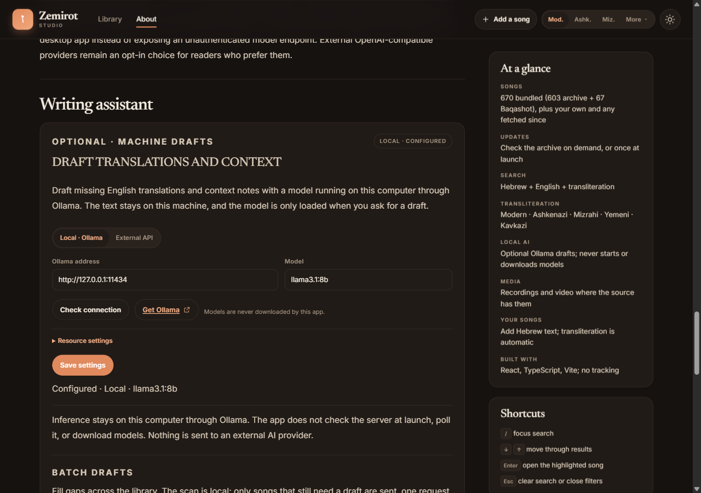
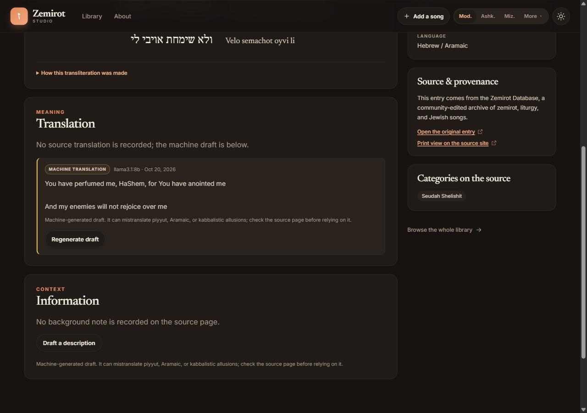

# Optional local AI

Zemirot Studio can draft an English translation or a short context note when a
song lacks one. This is an optional assistant, not part of search, reading,
transliteration, or navigation. The app is fully usable with no AI provider,
with Ollama stopped, or with the assistant unconfigured.

## What AI is used for

Only two explicit actions reach a model:

- **Draft an English translation** when the archive has none.
- **Draft a description or added context** from the supplied song metadata and
  text.

The app does not run a chatbot, generate recommendations, index the archive with
embeddings, or send text anywhere on startup. Search and transliteration remain
deterministic local code.

## Architecture

```
Renderer (React)
  └─ preload bridge (`window.zemirot.assist`)
       └─ Electron main process (`desktop/main.cjs`)
            ├─ `desktop/assist.cjs`  prompt, validation, records, concurrency
            └─ `desktop/ollama.cjs`  the only Ollama HTTP client
                 └─ http://127.0.0.1:11434/api/chat
```

- The renderer never calls Ollama or sees a provider key.
- `desktop/ollama.cjs` owns `/api/version`, `/api/tags`, and `/api/chat`.
  It accepts only loopback URLs (`localhost`, `127.0.0.1`, `::1`).
- `desktop/assist.cjs` owns prompts, JSON validation, saved drafts, one-at-a-time
  concurrency, cancellation, and the choice between Ollama and the optional
  OpenAI-compatible provider.
- Generated records stay in the app's user-data folder under `assist/`.
- Streaming progress crosses IPC as a throttled character count. Partial JSON is
  never shown or accepted as a result.

## Files

New:

- `desktop/ollama.cjs` — the Ollama client (check, streamed chat, cancellation).
- `docs/local-ai.md` — this guide, with the screenshots beside it.

Changed:

- `desktop/assist.cjs` — provider choice, prompts, validation, concurrency,
  settings, records.
- `desktop/main.cjs` — `assist:*` IPC handlers and progress forwarding.
- `desktop/preload.cjs` — the narrow `assist` bridge.
- `src/lib/assist.ts` — settings, status, stream and record types on the renderer
  side.
- `src/components/WritingAssistant.tsx` — provider toggle, connection check, model
  picker, resource settings, batch runner.
- `src/components/SongPage.tsx` — draft blocks, progress row, cancel.
- `src/components/AboutPage.tsx` — the local-AI explanation and privacy note.
- `src/styles.css` — assistant layout, progress row, model list, print rules.
- `src/lib/assist.test.ts` — error-unwrapping and caveat tests.

No dependencies were added; the client uses Node's built-in `fetch`.

## What it looks like





## Setup

1. Install and start [Ollama](https://ollama.com/download) on the same computer
   as the desktop app.
2. Pull a multilingual model in a terminal. Suggested starting point:

   ```sh
   ollama pull gemma3:4b
   ```

   `qwen2.5:7b-instruct` is a larger option when the hardware can spare the
   memory. The app never downloads a model itself.

3. Open **About → Writing assistant**, choose **Local · Ollama**, enter the model
   name, and press **Check connection**.
4. Pick an installed model and save.

The default address is `http://127.0.0.1:11434`. The app does not start Ollama,
poll it, or check it at launch. If the address is wrong or the server is stopped,
only the draft action fails; the rest of the app continues normally.

## Resource settings

| Setting | Default | Purpose |
| --- | --- | --- |
| Timeout | 3 minutes | Covers a cold model load; cancellable at any time |
| Context | 8K tokens | Caps prompt size and KV-cache memory |
| Maximum output | 4K tokens | Prevents runaway generations |
| Model retention | 5 minutes | Balances reload cost against memory; `0` unloads immediately |

The prompt trims song text and metadata to fit the selected context window.
Only one generation runs at a time. A second draft request is rejected with a
clear message rather than queueing unbounded work. Local batch drafts are capped
at eight songs per run.

## Browser-hosted edition

The browser edition does not expose the assistant. A browser on a reader's
computer cannot rely on the server's `localhost`, Ollama does not allow arbitrary
web origins by default, and publishing an unauthenticated inference endpoint
would be unsafe. Local AI therefore lives in the desktop main process. External
OpenAI-compatible providers remain an opt-in alternative in the desktop app.

## Privacy and data

- Local inference uses Ollama on the same computer. With the default provider,
  song text is not sent to an external AI service.
- No prompt or response is logged by the app.
- Generated drafts are stored locally so they can be shown again. They never
  replace source text or translations and are always labelled machine-generated.
- External-provider keys are encrypted with the operating system credential
  store. Local Ollama needs no key.
- Model output is untrusted. It is parsed as JSON, type-checked, length-limited,
  and required to contain the requested fields before it is stored.

## Limitations

- Translation quality depends entirely on the selected local model. Small models
  can mistranslate piyyut, Aramaic, or kabbalistic allusions.
- Very long songs are truncated to fit the configured context; increase the
  context setting deliberately if the hardware allows it.
- The app cannot verify a model's scholarly accuracy. Drafts are reading aids,
  not a critical edition.
- The browser edition has no local-AI bridge.
- No model is installed or downloaded automatically.
